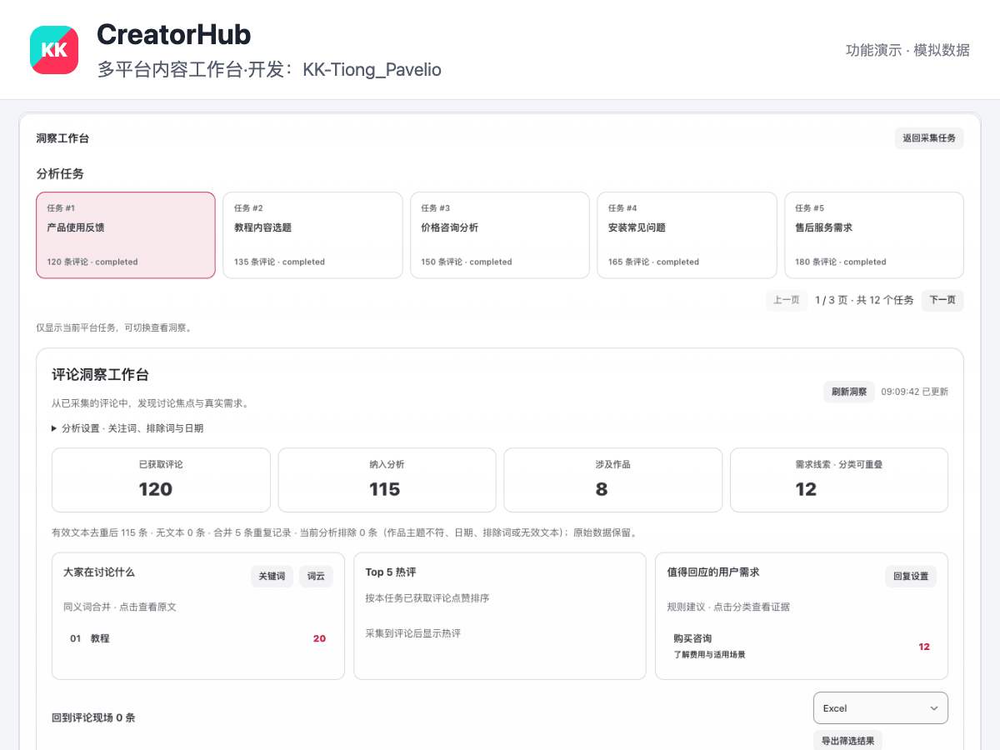
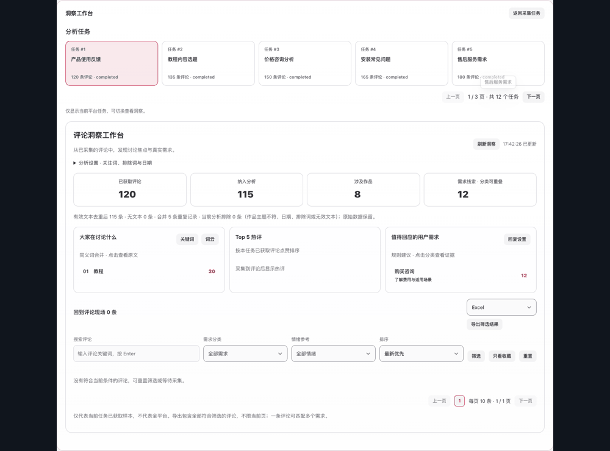
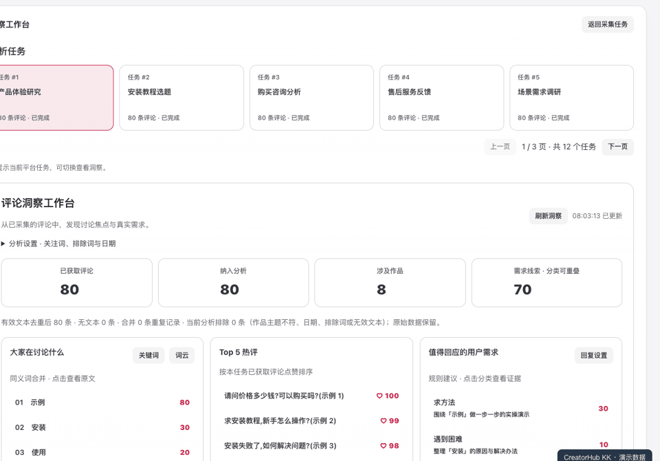
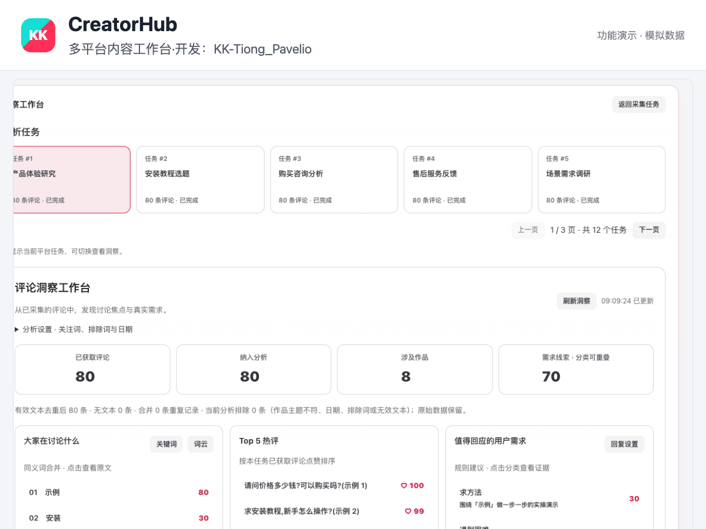
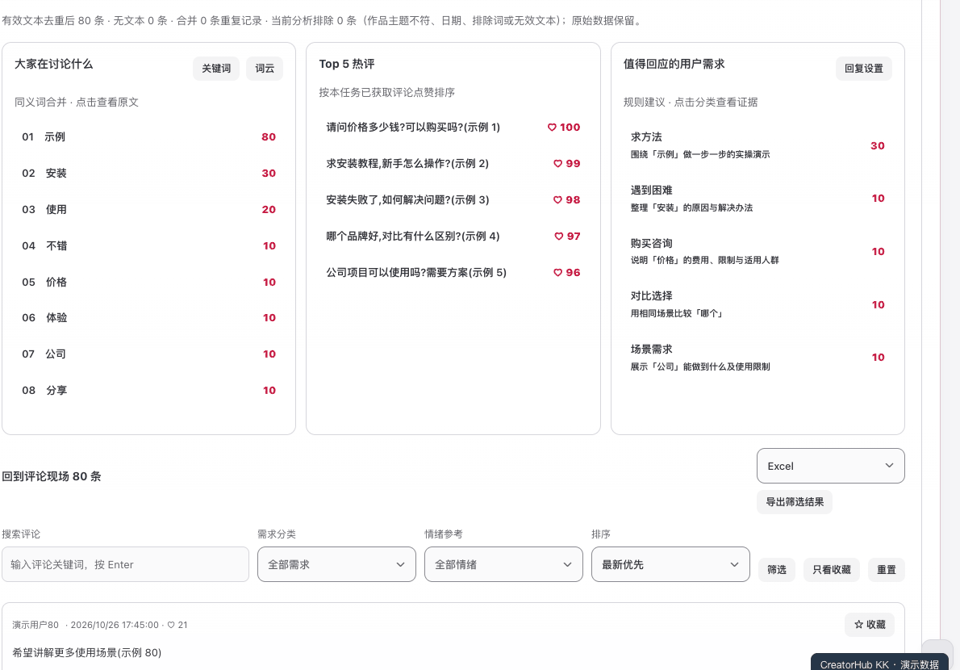
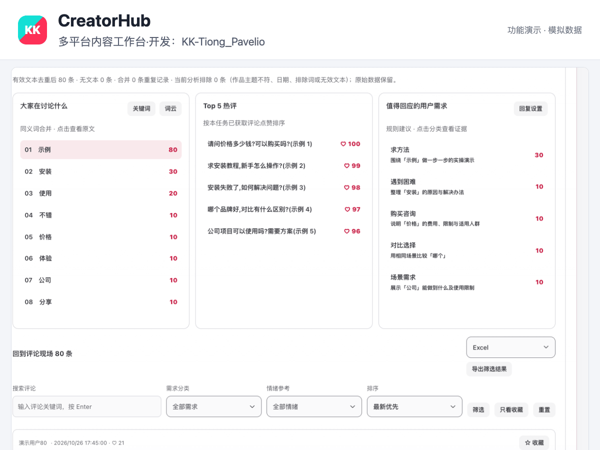
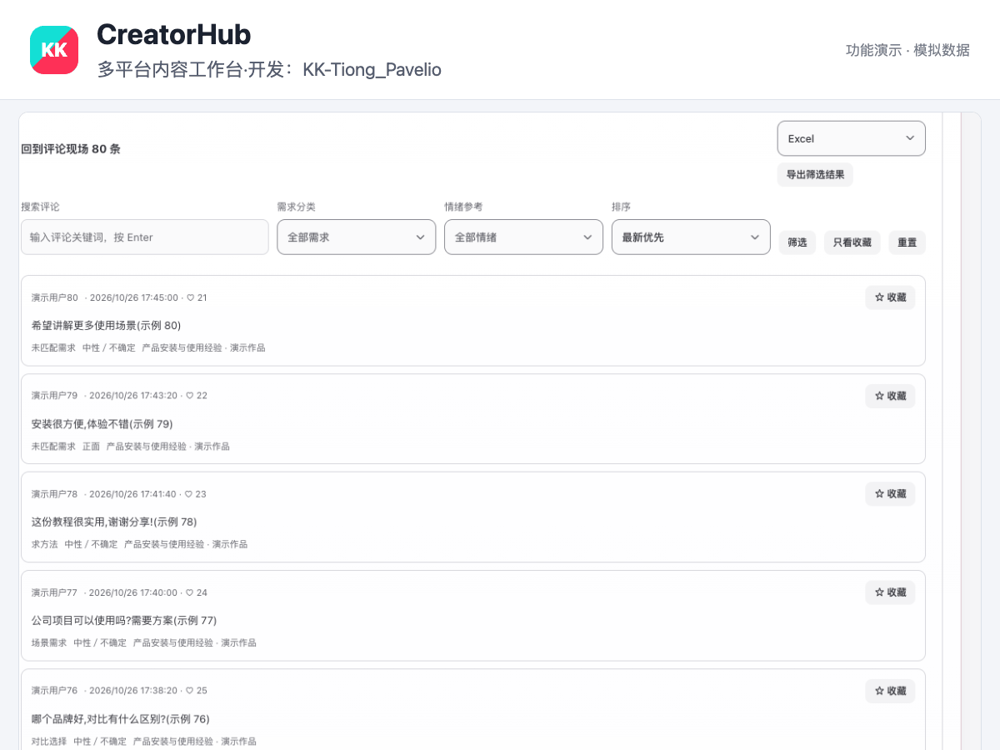
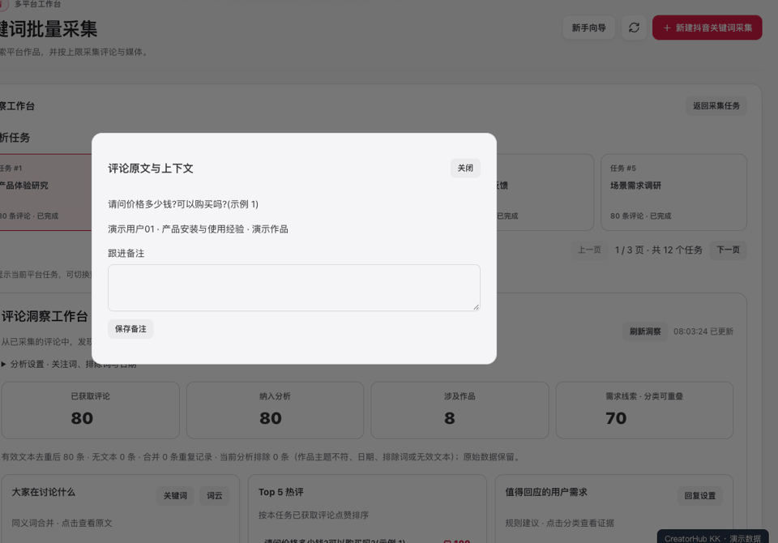
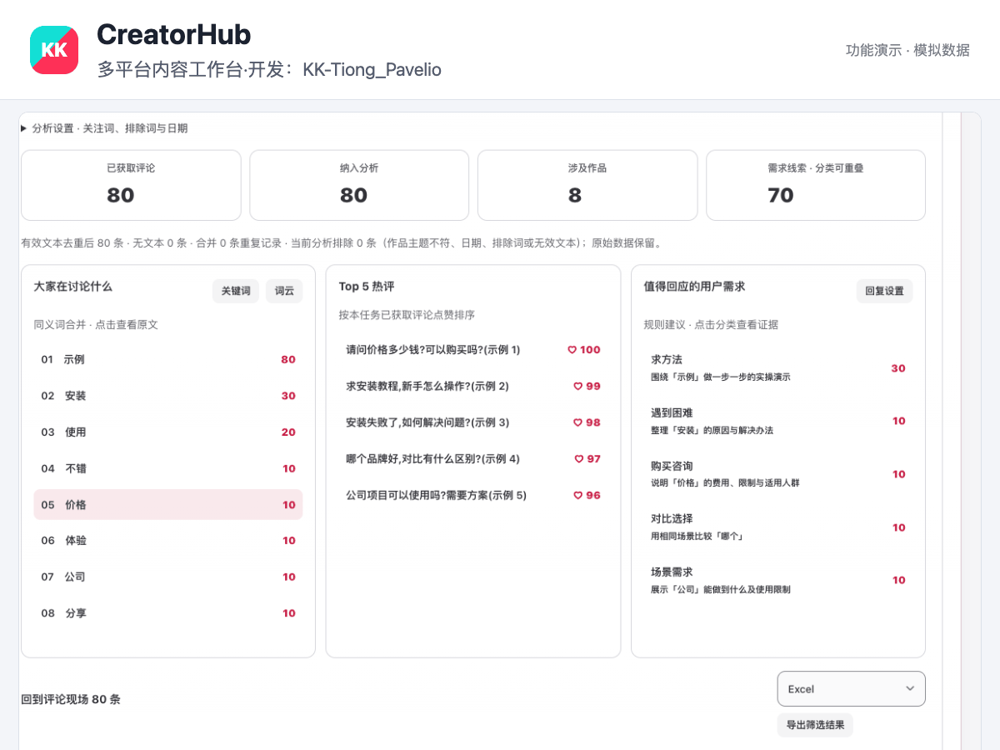
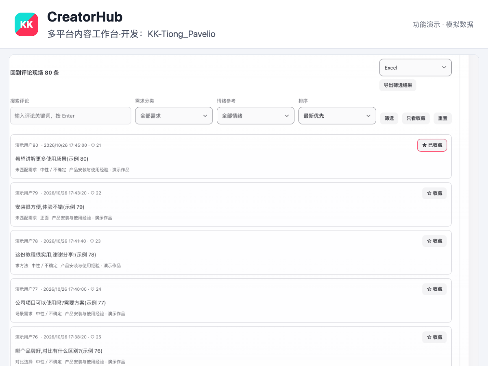

# CreatorHub KK

多平台内容工作台 · 开发：KK-Tiong_Pavelio

独立维护的多平台内容与评论洞察工作台，源码、Windows 安装版和更新记录统一在本项目发布。

## 下载

- **KK 增强版 Windows 10/11 x64 EXE**：[Releases](https://github.com/ichxjz/CreatorHub-KK-/releases/latest)。仅已完成 Windows 构建和自动冒烟测试的版本提供安装包；若尚无附件，请等待 Actions 完成。
- [构建进度](https://github.com/ichxjz/CreatorHub-KK-/actions/workflows/windows-installer.yml)
- [完整源码 ZIP](https://github.com/ichxjz/CreatorHub-KK-/archive/refs/heads/main.zip)

增强版使用独立的 `CreatorHub-KK` 安装和用户数据目录，更新来自本项目。不会自动迁移原版账号；首次使用需登录。内置 Node.js 用于洞察分析，无需另装 Node。安装器未做商业代码签名，系统可能显示未知发布者。

## Windows 客户端

双击启动后，自动进入与网页修改版相同的工作台。采集、评论洞察、5列任务卡片、分页、飞书导出和账号同步共用同一套功能。客户端菜单中的「服务与更新」负责诊断、停止与升级；无需先在启动中心手动启动。首次启动需联网准备浏览器组件。

安装包下载：[Windows 最新版](https://github.com/ichxjz/CreatorHub-KK-/releases/latest)。Windows 电脑需要自行登录平台；Mac 的账号和采集数据不会随公开安装包分发。

## 功能演示（模拟数据）

每行两张，点击动图查看大图。使用真实界面与模拟数据录制，不包含用户账号或采集记录。

<table>
<tr>
<td width="50%" align="center"><strong>分析任务卡片</strong><br><a href="assets/kk/task-cards.gif"></a></td>
<td width="50%" align="center"><strong>自适应布局</strong><br><a href="assets/kk/responsive.gif"></a></td>
</tr>
<tr>
<td width="50%" align="center"><strong>任务快速切换</strong><br><a href="assets/kk/01-task-switch.gif"></a></td>
<td width="50%" align="center"><strong>任务卡片分页</strong><br><a href="assets/kk/02-task-pages.gif"></a></td>
</tr>
<tr>
<td width="50%" align="center"><strong>关键词查看原评论</strong><br><a href="assets/kk/03-keyword-drilldown.gif"></a></td>
<td width="50%" align="center"><strong>需求分类筛选</strong><br><a href="assets/kk/04-needs.gif"></a></td>
</tr>
<tr>
<td width="50%" align="center"><strong>评论搜索</strong><br><a href="assets/kk/05-comment-search.gif"></a></td>
<td width="50%" align="center"><strong>收藏与跟进</strong><br><a href="assets/kk/06-favorites.gif"></a></td>
</tr>
<tr>
<td width="50%" align="center"><strong>评论数字分页</strong><br><a href="assets/kk/07-comment-pages.gif"></a></td>
<td width="50%" align="center"><strong>上下文与备注</strong><br><a href="assets/kk/08-context-notes.gif"></a></td>
</tr>
<tr>
<td width="50%" align="center"><strong>分析设置</strong><br><a href="assets/kk/09-analysis-options.gif"></a></td>
<td width="50%" align="center"><strong>飞书连接设置</strong><br><a href="assets/kk/10-feishu-setup.gif"></a></td>
</tr>
</table>

## KK 新增与修改

- 洞察独立入口：统计、关键词、热评、需求分类、关注词/排除词/日期筛选。
- 分析任务每页五张卡片，桌面一行五列，上一页/下一页，手机自动换行。
- 评论每页十条，数字分页、收藏、备注、上下文、用户主页、原评论定位。
- Excel/CSV/JSON、关键词与词云、飞书多维表格导出。
- 关键词清理编号，作品标题与任务主题关联过滤；原始数据保留。规则过滤不等同语义模型，可能漏掉标题未提及主题的作品。
- 每平台最多五任务并行，同账号仍顺序执行并保留平台间隔与风控。
- 登录后/进入我的内容时自动同步，合并重复请求，显示等待、部分失败及重试。
- 两行品牌署名，任务按钮顺序优化，队列部分完成状态修正。

## 源码运行

需 Python 3.12、Node.js 24+、Git、系统 Chrome。安装依赖后按[使用指南](USER_GUIDE.md)启动：

```sh
git clone https://github.com/ichxjz/CreatorHub-KK-.git
cd creatorhub
python -m venv .venv
# Windows: .venv\Scripts\activate
# macOS/Linux: source .venv/bin/activate
pip install -r requirements.txt
python creatorhub.py
```

配置仅使用本地 `config.yaml`，不要提交 Cookie、账号数据库或 API Key。

## 能力与验证范围

平台支持范围见[平台能力](USER_GUIDE.md#平台能力)：关键词批量采集支持抖音和小红书；快手/视频号不因此获得全站关键词搜索能力。平台验证需要本人完成。评论定位受登录、折叠、删除与懒加载影响，未找到会明确提示；需求分类不会自动发送回复。

本机验证了抖音实采数据、评论定位和部分账号同步；其他平台及真实飞书上传未全面验收。Windows 自动构建与服务冒烟测试不代表所有平台登录采集均已人工测试。

## 代码声明

来源与第三方许可见 [NOTICE.md](NOTICE.md)。

## 验证与构建

```sh
python -m unittest discover -s tests_kk -p "test_*.py" -q
node --test tests_kk/feishu.test.mjs
```

Windows 构建源码在 `desktop/`，自动构建流程在 `.github/workflows/windows-installer.yml`。Release 包含 EXE 与 SHA256 校验文件。
